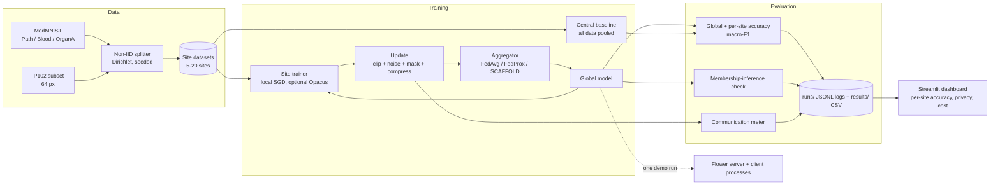

# PLAN.md: FedSurveil

Privacy-preserving federated learning for image classification. A simulated network of 5–20 clinics or field sites trains one shared model without sharing raw images. The project compares FedAvg, FedProx and SCAFFOLD against central training, adds differential privacy and a simulated secure aggregation, and shows how much communication each method needs.
Budget: 7 weeks of evenings and weekends, free compute (Kaggle/Colab GPU), free hosting, laptop and phone only.
Honest framing: this is a **simulation on one machine**. No real network, no real hospitals. Privacy claims are measured (epsilon, a membership-inference check), not assumed.

## Scope

| Area | Decision |
|---|---|
| Datasets | **MedMNIST v2** (pip `medmnist`, small 28/64 px images): PathMNIST, BloodMNIST, OrganAMNIST as the medical track. **IP102** (insect pests, 102 classes, about 75k images) as the field-site track, restricted to a subset (e.g. top 10–20 classes, resized to 64 px). |
| Licences | MedMNIST data CC-BY-4.0, **except DermaMNIST (CC-BY-NC-4.0, so not used)**; code Apache-2.0; "not for clinical use". IP102: the authors say "free for academic usage", other uses need written permission. A Roboflow mirror says CC-BY-4.0 but the authors' terms win, so IP102 is not redistributed and the README says so. Checked 2026-11-18. |
| FL algorithms | **FedAvg, FedProx, SCAFFOLD**, written as small plain-PyTorch functions in one simulation loop (about 100 lines each). Flower is used for one end-to-end run (server and clients as separate processes) to show the real protocol, not as the engine for every experiment. |
| Why not Flower for everything | Its simulation engine runs on Ray, which is experimental on native Windows (Flower recommends WSL2). I have not verified that SCAFFOLD ships as a built-in strategy. A plain loop is faster to debug, runs on Kaggle, and I understand every line. |
| Non-IID splits | Dirichlet label split (alpha 0.1, 0.5, 100 for near-IID), plus size imbalance across sites. Seeded and saved to `data/splits/`. |
| Models | Small CNN (28 px) and a small ResNet-style net (64 px). Group norm instead of batch norm (batch norm breaks under non-IID and under DP). No pretrained backbones in the main runs. |
| Privacy | **Opacus** DP-SGD on each site (sample-level DP). **Client-level DP** by clipping and noising each site's update on the server (own code, about 30 lines). Report epsilon with delta fixed. |
| Secure aggregation | **Simulated** pairwise-mask protocol (masks cancel in the sum). Shows the idea and its cost; **no real cryptography, no dropout recovery**. Stated plainly in the report. |
| Privacy check | A simple loss-threshold membership-inference attack on the final model, with and without DP. Measures leakage; no attack on real people. |
| Communication cost | Bytes per round per site, rounds to reach a target accuracy, total MB. Optional top-k and int8 update compression. |
| Dashboard | Streamlit + Plotly. Reads logged run files, with a replay mode that looks live. No GPU needed on the host. |
| Secrets | None needed. Datasets download without tokens. `.env.example` holds optional names only. |
| Out of scope | Real cryptographic secure aggregation, real networks and hardware, vertical or split learning, clinical claims, personalised FL, models larger than a small ResNet. |

## 1. Architecture



- **Splitter**: partitions a dataset across sites with a Dirichlet label skew and uneven sizes. Saves the partition so every method sees identical data.
- **Site trainer**: a few local epochs of SGD on one site's data. FedProx adds a pull toward the global model. SCAFFOLD adds a drift-correction term using control variates. Opacus wraps it for DP-SGD.
- **Update pipeline**: what leaves a site: model delta, then optional clipping, noise, compression and masking. Each step is a small separate function with its own test.
- **Aggregator**: combines updates into the new global model. Holds SCAFFOLD's server control variate.
- **Central baseline**: the same model trained on all data pooled, the upper bound.
- **Evaluation**: global test accuracy and macro-F1, **per-site** accuracy (fairness), and the gap to central training.
- **Communication meter**: counts bytes sent each round, so cost is measured, not estimated.
- **Dashboard**: type a configuration, or replay a logged run, and see per-site accuracy curves, the privacy-accuracy trade-off and communication cost.

**Metrics**
- **Global accuracy and macro-F1** on a held-out balanced test set; **gap to central training**.
- **Per-site accuracy** and its spread (worst site, standard deviation).
- **Rounds to target accuracy** (e.g. 80% of central accuracy).
- **Privacy**: epsilon at fixed delta (1e-5) for each DP setting, plus membership-inference AUROC (0.5 means no leakage).
- **Communication**: MB per round and total MB to target accuracy, with and without compression.
- **Variance**: 3–5 seeds, mean with 95% confidence intervals (t-interval over seeds).

## 2. Compute budget

| Part | Where | Size |
|---|---|---|
| MedMNIST runs (28 px, small CNN) | Kaggle or Colab GPU, or laptop CPU | Minutes per run. 20 sites x 50 rounds fits easily. |
| IP102 runs (64 px, 10–20 classes) | Kaggle or Colab GPU | The archive is about 3 GB. Preprocess once to a small `.npz` and upload that as a private Kaggle dataset. |
| Opacus runs | GPU | Slower than plain SGD (per-sample gradients), so the DP grid stays small. |
| Flower demo | Laptop, or WSL2 | A few processes, tiny model. |
| Dashboard, plots | Laptop | From logged files only. |

Kaggle gives about 30 GPU hours a week, but the figure floats: check your own quota in week 1. Every run writes its logs to files, so a lost session costs nothing. Laptop RAM and GPU are unknown, so CPU runs are not assumed.

## 3. Repo structure

```
fedsurveil/
├── fedsurveil/
│   ├── data/          # load.py (MedMNIST, IP102), partition.py (Dirichlet splits)
│   ├── models/        # cnn.py, resnet_small.py
│   ├── fl/            # client.py, fedavg.py, fedprox.py, scaffold.py, simulate.py
│   ├── privacy/       # dp_sgd.py (Opacus), client_dp.py, secagg.py, membership.py
│   ├── comms/         # meter.py, compress.py
│   ├── flower_demo/   # server.py, client.py (one real-protocol run)
│   ├── eval/          # metrics.py, report.py
│   └── config.py      # datasets, seeds, hyperparameters
├── notebooks/         # Kaggle/Colab runners
├── app/               # Streamlit dashboard
├── runs/              # per-run JSONL logs (small, committed selectively)
├── data/              # splits, manifest, licence notes (raw data gitignored)
├── results/           # CSVs, charts, limitations, run_meta.json
├── docs/              # research-style report
├── tests/
├── .env.example
├── .pre-commit-config.yaml
└── README.md, PLAN.md, BUILD_STEPS.md, CLAUDE.md, LEARNING.md
```

**Keeping keys out of git**: no secret is required, but `.env` is gitignored from the first commit, `.env.example` lists names only, and `pre-commit` runs **gitleaks** on every commit. Large data and model files are gitignored.

## 4. Week-by-week

| Week | Goal | Done when |
|---|---|---|
| 1 | Skeleton + data | Repo, pre-commit, gitleaks and CI in place. MedMNIST loads. IP102 downloaded, a 10–20 class subset chosen and preprocessed to `.npz`. Kaggle quota checked. Licence table in the README. |
| 2 | Non-IID splits + centralized baseline | Dirichlet partitioner with saved splits and a plot of each site's class mix. Central baseline accuracy for each dataset. **Check: does non-IID visibly hurt FedAvg?** |
| 3 | FL engine: FedAvg + FedProx | Simulation loop, communication meter, logged runs, unit tests (aggregation maths, determinism). FedAvg and FedProx curves on one MedMNIST set across three alpha values. |
| 4 | SCAFFOLD + comparison | SCAFFOLD working and tested. All three methods vs central on MedMNIST and IP102, 3 seeds. Per-site accuracy table. |
| 5 | Privacy | Opacus DP-SGD and client-level DP, epsilon reported. Simulated secure aggregation (masks cancel, tested). Membership-inference check with and without DP. **Decision: which DP settings are practical on a small model.** |
| 6 | Communication + dashboard | Compression (top-k, int8) and low-bandwidth analysis. Streamlit dashboard on logged runs with replay mode. One Flower end-to-end demo run. |
| 7 | Evaluation + ship | Repeat runs for variance, results table, 2–3 charts, limitations section. Deploy, README, report, portfolio card. No new features. |

## 5. Risks and first checks

1. **Data access and licences.**

   | Source | Licence (checked 2026-11-18) |
   |---|---|
   | MedMNIST v2 data | CC-BY-4.0, **except DermaMNIST CC-BY-NC-4.0 (excluded)**; not for clinical use |
   | MedMNIST code | Apache-2.0 |
   | IP102 | "Free for academic usage"; other uses need permission from the authors. Third-party mirrors claiming CC-BY are not authoritative. Not redistributed. |
   | Flower | Apache-2.0 (to confirm when installed) |
   | Opacus | Apache-2.0 (to confirm when installed) |

   IP102 is a 3 GB download hosted on Google Drive or AliyunDrive, which may be slow or rate-limited. *Check first (week 1):* the download works, and if the licence matters for a public demo, whether to email the authors. The public dashboard shows only metrics, never IP102 images. Pin the `medmnist` version, since 3.x changed the data sizes.
2. **Compute and platform.** Opacus slows training and uses more memory because it stores per-sample gradients. Flower's Ray simulation is experimental on Windows. *Check first:* a DP-SGD run on Kaggle for one site, your Kaggle quota, and that the plain-loop simulator runs on your laptop.
3. **Privacy claims can mislead.** DP-SGD protects a single training example. Client-level DP protects a whole site. They are different guarantees, and secure aggregation here is simulated, not real cryptography. *Check first:* write down which guarantee each setting gives before running anything, and put it in the report.

**Other risks.** (a) SCAFFOLD is easy to implement wrongly: test it against a one-site case where it must match plain SGD. (b) Batch norm silently breaks FL and DP, so use group norm from the start. (c) Non-IID may barely hurt on easy datasets: check in week 2, and use a harder subset if so. (d) MedMNIST images are tiny, so results do not transfer to real clinical images, and the report says so.

## 6. Simplifications

- Plain-PyTorch simulator for all experiments, Flower for one real-protocol demo only.
- Secure aggregation is simulated pairwise masking, no dropout handling.
- Small models, 28/64 px images, no pretraining.
- A subset of IP102 (10–20 classes), not all 102.
- A small DP grid (a few noise levels), not a full sweep.
- Dashboard from logged runs, so hosting needs no GPU. **Free hosting:** Hugging Face Spaces or Streamlit Community Cloud, chosen in step 7.

## Concepts (plain language + one reading each)

- **Federated learning**: train one model by sending model updates, not data, between sites and a server. *Read:* McMahan et al. 2017, "Communication-Efficient Learning of Deep Networks from Decentralized Data" (FedAvg, arXiv).
- **Non-IID data**: each site sees a different slice of the world, so local training pulls the model in different directions ("client drift"). *Read:* Hsu et al. 2019, "Measuring the Effects of Non-Identical Data Distribution for Federated Visual Classification" (arXiv).
- **FedProx**: adds a penalty that keeps each site's model near the global model. *Read:* Li et al. 2020, "Federated Optimization in Heterogeneous Networks" (arXiv).
- **SCAFFOLD**: uses correction terms (control variates) to cancel client drift. *Read:* Karimireddy et al. 2020, "SCAFFOLD: Stochastic Controlled Averaging for Federated Learning" (arXiv).
- **Differential privacy and DP-SGD**: add calibrated noise so one person's data barely changes the output; epsilon measures how much. *Read:* Abadi et al. 2016, "Deep Learning with Differential Privacy" (arXiv).
- **Secure aggregation**: sites add secret masks that cancel in the sum, so the server sees only the total. *Read:* Bonawitz et al. 2017, "Practical Secure Aggregation for Privacy-Preserving Machine Learning".
- **Membership inference**: guessing whether a record was in the training set, which measures leakage. *Read:* Shokri et al. 2017, "Membership Inference Attacks Against Machine Learning Models" (arXiv).
- **Communication cost**: bytes sent per round often matter more than compute at low-bandwidth sites. *Read:* Konecny et al. 2016, "Federated Learning: Strategies for Improving Communication Efficiency" (arXiv).
- **Variance and confidence intervals**: one run gives a noisy number, so repeat with several seeds and report an interval. *Read:* the Wikipedia article "Confidence interval" (Student's t section).
