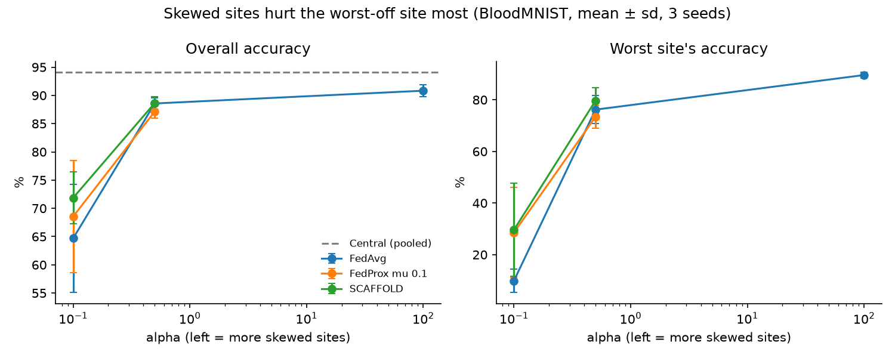
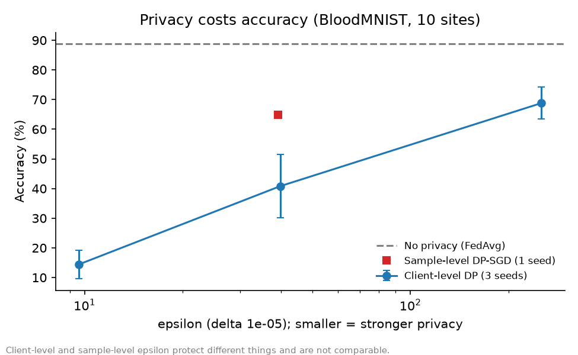
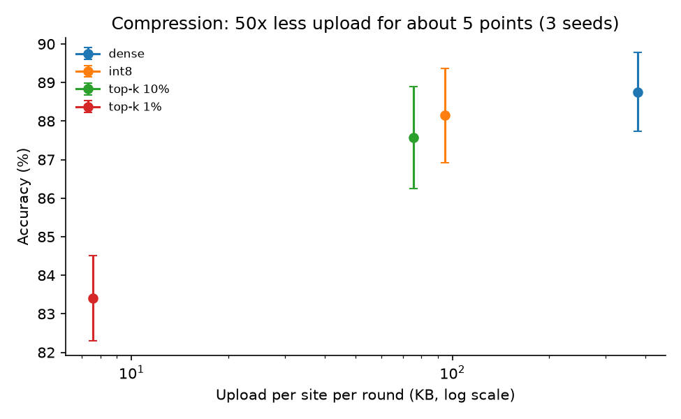

# FedSurveil: results and limitations

A single-machine simulation of federated learning across 10 sites, on tiny public medical images.
It makes no clinical claims. All numbers below come from [results/results_table.md](../results/results_table.md)
(3 seeds, final round, mean ± standard deviation) and can be rebuilt with
`python -m fedsurveil.eval.report`.

## Setup

- **Data:** BloodMNIST (8 classes, 28 px), split over 10 sites with a Dirichlet label skew
  (alpha 0.1 strongly skewed, 0.5 moderate, 100 near-IID) and uneven site sizes.
- **Model and training:** a small CNN with group norm (379 KB), 30 rounds, 2 local epochs, learning
  rate 0.02, momentum 0.9, batch 64. Settings were chosen once and not tuned.
- **Hardware:** a free Colab Tesla T4. Seeds 0, 1 and 2 fix the split and the initial weights.
- **Not run:** PathMNIST, OrganAMNIST and the IP102 pest subset. The data pipeline handles them
  (the files are built), but no model was trained on them, so **every result here is BloodMNIST
  only**. The original plan called for IP102 too; that part is not done.

## What the results say

**1. Skewed sites hurt, and an overall average hides who is hurt most.** Central training reaches
94.1 ± 0.9%. FedAvg with near-IID sites reaches 90.8 ± 1.1%, at alpha 0.5 88.6 ± 1.0% and at
alpha 0.1 only 64.7 ± 9.6%. At alpha 0.5 the overall number looks fine, but the worst site gets
76.2 ± 5.4%; at alpha 0.1 it gets 9.9 ± 4.5%.

**2. SCAFFOLD helps under strong skew; FedProx helps only a little and can hurt.** At alpha 0.1,
SCAFFOLD reaches 71.9 ± 4.6% (FedAvg 64.7 ± 9.6%) and its worst site 29.6 ± 18.1% (FedAvg
9.9 ± 4.5%). FedProx with mu 0.1 is similar (68.5%, worst site 28.5%); mu 1.0 is worse than FedAvg
everywhere (58.8% at alpha 0.1, 74.4% at alpha 0.5). At alpha 0.5 nothing beats FedAvg by more than
noise. The spreads at alpha 0.1 overlap, so with 3 seeds this is suggestive, not established.
SCAFFOLD also uploads twice as much per round (757.8 KB against 378.9 KB per site).

**3. Meaningful privacy costs most of the accuracy here.** Which guarantee each row gives:

| Setting | Guarantee | Accuracy |
|---|---|---|
| Plain FedAvg | none | 88.8 ± 1.0% |
| Simulated secure aggregation | none by itself: it is a simulation of pairwise masking, not cryptography | 89.0 ± 1.2% |
| Client-level DP, noise 0.3 | protects a whole site: epsilon 253, delta 1e-5 (a very weak bound) | 68.8 ± 5.4% |
| Client-level DP, noise 1.0 | protects a whole site: epsilon 40 | 40.8 ± 10.7% |
| Client-level DP, noise 3.0 | protects a whole site: epsilon 10 | 14.4 ± 4.8% |
| DP-SGD, noise 1.0 (one seed) | protects a single training image: epsilon 39 | 64.8% |

Client-level and sample-level epsilon protect different things and are not comparable to each other.
The answer to the plan's week-5 question, which DP settings are practical on a small model with 10
sites, is **none at client level**: with only 10 sites each update carries a large share of the
signal, so any noise strong enough to give a small epsilon destroys the model. Sample-level DP-SGD
looked less costly, but it has one seed and no repeat.

The membership-inference attack (a simple loss threshold) scored an AUROC of 0.50–0.52 in every run,
including the non-private baseline. That means this attack found no leakage. It does **not** show the
model is safe: the attack is weak and the model is small, and the result says nothing about stronger
attacks.

**4. Compression is cheap down to about 10x, and costly beyond that.** Against 378.9 KB dense per
site per round: int8 (4x smaller, 94.7 KB) loses 0.7 points (88.1 ± 1.2%); top-k 10% (5x, 75.8 KB)
loses 1.2 points (87.6 ± 1.3%); top-k 1% (50x, 7.6 KB) loses 5.4 points (83.4 ± 1.1%) and its worst
site drops to 66.8%. These runs have no privacy and no secure aggregation: compression was not combined with
either (see Limitations).

**5. The real protocol runs.** A Flower demo ran FedAvg as separate server and client processes for
5 rounds on a 3,000-image subset, reaching 58% accuracy from a random start
([results/flower_demo.json](../results/flower_demo.json)). It is a protocol demo with no privacy and
no comparison, not a result.

## Limitations

- **One dataset.** Only BloodMNIST was trained. PathMNIST, OrganAMNIST and IP102 were not, so nothing
  here says the findings carry over to other data.
- **Few seeds, rough spreads.** Three seeds (one for DP-SGD) and no confidence intervals. The same
  seed and settings gave final accuracies up to 0.7 points apart in two separate Colab sessions
  (FedAvg at alpha 0.5, seeds 0, 1 and 2: 0.2, 0.7 and 0.1 points), most likely GPU
  non-determinism, which was not investigated. Differences of about one point are noise.
- **Not converged, not tuned.** 30 rounds was not enough for FedAvg at alpha 100 to finish improving,
  so its gap to central training is probably overstated. One setting of learning rate, momentum and
  local epochs was used for every method, which may favour some methods over others. FedProx's mu
  and the DP clipping norm (set to the median update norm from a short pilot run) were not tuned.
- **Worst-site numbers are noisy.** Each site is scored on 500 test images sampled from the shared
  test set, and sites differ between seeds.
- **Privacy is narrow.** Epsilon uses delta 1e-5 and is reported per guarantee (client-level or
  sample-level), never both at once, and no run combines DP with compression or SCAFFOLD.
  The membership-inference check is one simple attack. Secure aggregation is simulated masking:
  there is no cryptography, no dropout handling and no protection against a dishonest server.
- **Compression** is applied to the update going up only, and is not combined with secure
  aggregation or SCAFFOLD. Link-speed hours in [results/comms_report.md](../results/comms_report.md)
  are illustrative assumptions, not measurements of any network.
- **Tiny images, a simulation.** 28 px images, a small model, one machine. Nothing here transfers to
  real clinical images or real networks, and the work must not be used for clinical decisions.
- **Data quirks.** BloodMNIST's test set has 5 images that also appear in training (see
  [results/data_report.md](../results/data_report.md)).

## Reproducing

1. Tests, dashboard and report (laptop, no GPU): `pip install -r requirements-dev.txt`, then
   `pytest`, `python -m fedsurveil.eval.report` and `streamlit run app/dashboard.py`.
2. Experiments (free GPU): `pip install -r requirements-ml.txt`, then on a Colab T4
   `python scripts/run_step5.py 02`, `03` and `04` (roughly an hour in total). Step 4 (FedAvg and
   central) comes from notebook 01.
3. Step 5 ran at code commit 03969c9 with PyTorch 2.14.1 on a Colab T4. The simulator also writes
   library versions and the git commit into every run log.

## Licences

MedMNIST data CC-BY-4.0 (DermaMNIST excluded: CC-BY-NC); MedMNIST code, Flower: Apache-2.0. IP102
is "free for academic usage": it is not redistributed and no IP102 images appear in the dashboard.
This repository has no LICENSE file yet.
